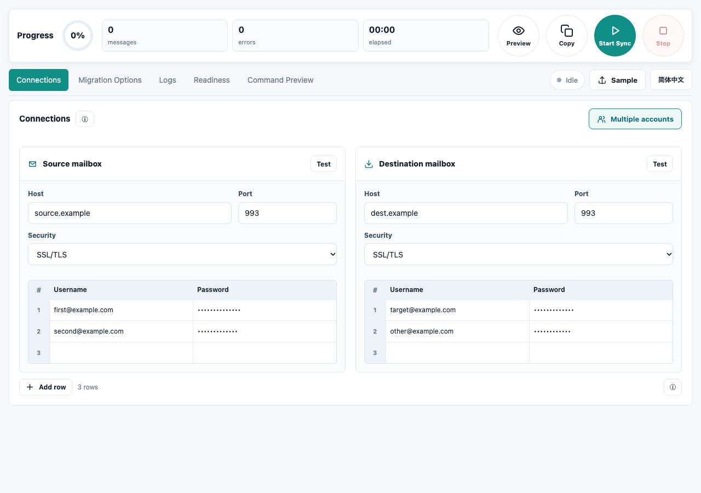

# Imapsync Studio

A desktop GUI for migrating email between IMAP servers, built with **Tauri 2, Rust, and Vite**. Transfer one account or queue multiple account pairs, preview commands, and monitor logs from a single window.

*Screenshot: English interface with example account data. No real mailbox transfer is shown.*

## Features

- Single-account and multiple-account migration modes.
- Connection presets for iCloud, Microsoft Exchange / Microsoft 365, Google, Yahoo Mail, Yahoo! JAPAN, AOL and Outlook.com; per-account Google and Microsoft OAuth with PKCE.
- Two credential sheets with paired rows and spreadsheet paste support.
- Shared server settings, dry runs, migration filters, and provider-friendly rate limits.
- Always-visible preview, copy, start, stop, and progress controls.
- TLS certificate and hostname verification for encrypted connections.
- Password masking in previews and logs; passwords excluded from saved drafts.
- English, Japanese, and Simplified Chinese interfaces.

## Requirements

Packaged applications include **imapsync 2.314, a Perl interpreter, required modules and TLS libraries**. End users do not need Homebrew, `brew install imapsync`, Perl or CPAN, and the app does not download a runtime on first launch. macOS Apple Silicon is verified locally; other platform/architecture runtime checks remain pending until CI and native testing complete.

Building from source requires Node.js/npm, Rust 1.89+ and the [Tauri 2 platform prerequisites](https://v2.tauri.app/start/prerequisites/). Engine builds also need a native C toolchain and Perl 5.40.x. On macOS, create isolated build toolchains in this repository:

```sh
npm ci
npm run engine:perl
npm run engine:openssl
npm run engine:deps
npm run engine:prepare
```

`engine:perl` and `engine:openssl` fetch checksum-pinned official sources and compile them inside the ignored `.engine-build/` directory; they do not replace system tools or install Homebrew packages. On Windows, use Strawberry Perl 5.40.x; on Linux, use Perl 5.40.x with compiler/OpenSSL development headers, then run `engine:deps` and `engine:prepare`. `IMAPSYNC_BUILD_PERL` can select a build interpreter; `OPENSSL_PREFIX` can select a build TLS toolchain. CPAN dependencies are installed locally, and their actual versions and packed file hashes are recorded in the generated engine notices. Product tests validate the resulting binary; dependency installation skips upstream module test suites.

The vendored imapsync source is pinned by commit and SHA-256 in [source.json](vendor/imapsync/source.json). PAR::Packer produces a native executable per target architecture. Cross-packaging another architecture's Perl is rejected; build on each target. The app launches only the bundled executable, without searching Homebrew or `PATH`, and ignores host Perl/PAR configuration. Preserve the complete application/installer; the GUI executable alone is insufficient. Third-party sources/licenses and build inventory are included alongside the engine; see [THIRD_PARTY_NOTICES.md](THIRD_PARTY_NOTICES.md).

## Run locally

```sh
npm ci
npm run tauri dev
```

Use the Tauri application for migration operations. The browser-only Vite interface does not provide the Rust backend needed to test connections or run imapsync.

## Migrate a single account

1. Open **Connections** and enter the source and destination host, port, and security mode. Typical ports are **993** for SSL/TLS and **143** for STARTTLS.
2. Enter the username and password for each mailbox.
3. Click **Test** on each side to check network and TLS connectivity. This check does not authenticate; authentication is tested when imapsync runs.
4. Open **Migration Options**. Keep **Dry run** enabled for the first run and configure any filters or limits.
5. Click **Preview**. The **Command Preview** tab opens automatically and shows the command with passwords masked. **Copy** copies that preview.
6. Click **Start Sync** to run the dry run, then review **Logs** for authentication failures, folder mappings, and errors.
7. After checking the results, turn off **Dry run** and click **Start Sync** to perform the migration.

**Sync deletes** enables deletion of destination messages missing from the source. Enable it only when that behavior is intended.

## Migrate multiple accounts

1. In **Connections**, click **Multiple accounts** at the right end of the section heading.
2. Enter the common source and destination server settings. These settings and the migration options apply to every pair.
3. Fill in the **Username** and **Password** columns in both sheets. Source row 1 maps to destination row 1, row 2 maps to row 2, and so on.
4. Use **Add row** to extend both sheets. Hover over a row number and click the × to remove that pair from both sheets.
5. To paste from Excel or another spreadsheet, copy two columns—username followed by password—and paste into a username cell. Each pasted line fills a row. Up to **1,000 rows** are supported.
6. Click **Preview** to review every account's command. Run a dry run first, then disable **Dry run** and start the actual migration.

All rows are validated before any migration starts. Completely empty pairs are skipped; incomplete pairs and duplicate destination accounts are rejected.

Pairs run **one at a time, from top to bottom**. An ordinary account failure is recorded and the queue continues; the overall run reports an error if any account fails. A process-launch failure or force-killed process stops the queue. **Stop** cancels execution of the current process and remaining pairs; interrupted queue checkpoints remain available for explicit recovery.

Row-number colors indicate running, successful, or failed accounts. The logs include row numbers and exit codes, while the top area shows the processed account count and aggregate transfer metrics. Hover over a row number for its result.

Click **Multiple accounts** again to return to single-account mode.

## Review results, retry selected rows and export

Open **☷ Migration results** in **Connections**. Select a run to inspect its original row numbers, source/destination usernames, result and exit code. Single-account transfers save successful, failed and stopped attempts, including dry runs, across application restarts. Real batch history also persists; batch dry-run results remain available for the current session. Each run is labelled Single account or Multiple accounts. Older reports may have unknown per-row counters, exported as blank/null values.

Use the search field for space-separated account, server, run ID or ISO timestamp terms (case-insensitive). Combine the result filter (**All successful**, **Failed or stopped**, **Unfinished**, **Running**) with **Migration** / **Dry run**. Filters match whole runs; the selected run keeps all its rows for viewing, retry selection and export. History is displayed 20 runs per page; use ‹ / › to navigate and ↻ to refresh.

The trash control removes the selected **completed** history after confirmation. **Cancel** is focused by default. Running attempts and unfinished batch queues cannot be deleted. Finished single-account attempts, including stopped attempts, can be deleted without removing their separate interruption-recovery records. Rust rechecks the record under the queue lock even if the screen is stale. Deletion removes that run's stored report; mailbox recovery matching records and lock files remain available. The latest completed in-memory dry-run report can also be removed for the current session.

Choose **Keep history** → **✓** to set **Forever** (the default), **30 / 90 / 180 days**, or **1 year**. Confirm the expired-report count before applying. The setting is saved locally; expired completed reports are removed immediately on confirmation, at application startup, and hourly while the app is open. Age is measured from completion; older reports without a completion timestamp use their file modification time. Selecting Forever stops automatic cleanup and removes no history.

Use **Clear completed history** to preview and confirm deletion across **all pages and search filters**. This includes successful and failed completed runs, finished/stopped single-account attempts, and the current session's completed batch dry run. Cancel is focused by default. Only the previewed runs are targeted, with completion state, retention age and execution locks checked again before each file is removed. Running attempts, unfinished batch queues, mailbox recovery records and lock files remain protected. The completion message reports deleted, skipped/protected and failed counts; cleanup can partially succeed if another instance locks a report or a file cannot be removed.

Select failed or stopped rows and click **Retry selected**. Successful and unstarted rows cannot be selected. This prepares a **new** credential-free queue, keeps the original results unchanged and retains the selected rows' original positions. Other rows are blank in the retry sheets. Re-enter the selected accounts' credentials, check the **Dry run**, then disable dry run to transfer. Settings and pairing are locked in resume mode; use **Resume account queue ×** to edit them as a new migration. Preparation does not start a transfer automatically.

Use **↓ CSV** or **↓ JSON** to choose a destination with the OS save dialog. Exports contain account/server identifiers, row status, exit codes and available counters, with `accountMode` in JSON and `account_mode` in CSV identifying single or multiple accounts. Single-account exports contain one account row; passwords, OAuth tokens, commands and logs are excluded. CSV uses UTF-8 with BOM, quoted fields and formula-prefix escaping for spreadsheet safety. Status values are stable English identifiers (`success`, `failed`, `stopped`, `pending`, `running`), independent of the UI language. Cancelling the save dialog writes no file.


The **Export all N matching runs** controls below the search filters export **every matching run across all pages**. Set the search text, result filter and Migration / Dry run filter, then use this area's **↓ CSV** or **↓ JSON**. The separate buttons next to **Run history** still export only the selected run. Matching is applied to whole runs, so a run matching **Failed or stopped** also exports its successful account rows.

Combined CSV uses the same columns as a single-run export, with one header and an account row for each run/account pair; `run_id` identifies the original run. Combined JSON contains `version`, `exportedAt`, normalized `filters`, `runCount`, `rowCount` and a `reports` array using the existing report schema. Single-account, multi-account, session dry-run, unfinished and running reports are included when they match the filters; running results are snapshots. Rust captures and serializes results before opening the save dialog, so later changes do not change that export. The displayed count is refreshed with search; the saved filename and completion message use the actual exported count. Empty matches disable the controls, and a newly empty result is rejected before a save dialog opens. Cancelling the save dialog writes no file.

## Connection presets

Choose a **Connection preset** independently in the source and destination mailbox cards. The preset fills and locks the host, port and encryption fields. Choose **Custom IMAP** to edit them; switching back restores the custom endpoint entered earlier in the current session. Existing usernames, passwords and multi-account rows are preserved when switching providers. Google selects Google OAuth; Exchange Online and Outlook.com select Microsoft OAuth. Other presets select password authentication. Cloud Microsoft presets disable password authentication and upgrade older preset drafts to OAuth. Drafts and interruption settings retain each side's preset.

All listed presets use **port 993 with SSL/TLS**. The values below were checked against the linked official provider documentation on 2026-10-31.

| Preset | IMAP host | Official settings |
| --- | --- | --- |
| iCloud | `imap.mail.me.com` | [Apple](https://support.apple.com/en-us/102525) |
| Microsoft Exchange / Microsoft 365 | `outlook.office365.com` | [Exchange Online](https://learn.microsoft.com/en-us/exchange/clients-and-mobile-in-exchange-online/pop3-and-imap4/pop3-and-imap4) |
| Google / Gmail / Google Workspace | `imap.gmail.com` | [Google](https://developers.google.com/workspace/gmail/imap/imap-smtp) |
| Yahoo Mail | `imap.mail.yahoo.com` | [Yahoo](https://help.yahoo.com/kb/SLN4075.html) |
| Yahoo! JAPAN | `imap.mail.yahoo.co.jp` | [Yahoo! JAPAN](https://support.yahoo-net.jp/PccMail/s/article/H000007321) |
| AOL | `imap.aol.com` | [AOL](https://help.aol.com/articles/how-do-i-use-other-email-applications-to-send-and-receive-my-aol-mail) |
| Outlook.com / Hotmail / Live | `outlook.office365.com` | [Microsoft](https://support.microsoft.com/en-us/outlook/pop-imap-and-smtp-settings-for-outlook-com) |

Hover or focus **ⓘ** beside the preset label for authentication and provider notes. iCloud, international Yahoo and AOL use app-specific passwords where required; Yahoo! JAPAN has its own external-client/IMAP access settings. The Exchange preset targets public Microsoft 365 / Exchange Online; use Custom IMAP for on-premises servers or other cloud endpoints.

Exchange Online removed IMAP basic authentication, including app-password access ([Microsoft policy](https://learn.microsoft.com/en-us/exchange/clients-and-mobile-in-exchange-online/deprecation-of-basic-authentication-exchange-online)). Use Microsoft OAuth for these cloud presets; use Custom IMAP for on-premises Exchange servers with other supported authentication settings.

## Microsoft 365 / Exchange Online and Outlook.com

1. Register a **public desktop application** in Microsoft Entra. To support both services, select **Accounts in any organizational directory and personal Microsoft accounts**. Add the **Mobile and desktop applications** redirect URI **`http://localhost/oauth/callback`**. The app selects an available loopback port at sign-in; Microsoft's localhost redirect rules ignore the port. Do not register the redirect as a Web/SPA callback and do not create a client secret. See [Microsoft's desktop redirect guidance](https://learn.microsoft.com/en-us/entra/identity-platform/reply-url).
2. Configure/consent the delegated IMAP scope **`https://outlook.office.com/IMAP.AccessAsUser.All`** using [Microsoft's IMAP OAuth instructions](https://learn.microsoft.com/en-us/exchange/client-developer/legacy-protocols/how-to-authenticate-an-imap-pop-smtp-application-by-using-oauth). The app also requests `offline_access`, `openid`, `profile` and `email`. It does not use Microsoft Graph mail permissions or application-only mailbox access. Your organization may require administrator consent and IMAP enablement; Outlook.com may require enabling IMAP in account settings.
3. Open **⚙ OAuth settings**, select **Microsoft**, enter the application's **Client ID** GUID, and save. Select the Exchange/Microsoft 365 or Outlook preset on the appropriate mailbox side, enter the account's sign-in username, then click **Sign in with Microsoft**. Complete sign-in/consent in the system browser and return to the app. The authenticated username must match the entered account; an empty username is filled after sign-in.
4. For multiple accounts, each side can independently use Google, Microsoft or password authentication. Sign in for every unfinished active row before starting. A connected account is reused within its provider; signing out from Microsoft does not remove Google grants. Restored queues keep their original account pairing and provider-specific authentication settings; completed rows need no new credentials.

Rust validates Microsoft ID-token RSA signatures against Microsoft's fixed HTTPS key endpoint, and checks audience, tenant-bound issuer, expiry and nonce before accepting the signed-in identity. Access/refresh tokens stay in Rust and the OS credential store (or memory when persistence is unavailable); the WebView receives account metadata only. Google and Microsoft use separate configuration files and credential-store services. Short-lived private files supply XOAUTH2 tokens to imapsync. Expiring tokens are refreshed, including refresh-token rotation; revoked grants or refresh failures stop the current run and remaining queued work so accounts can be reauthenticated before recovery. Disconnect removes local grants; revoke consent separately in the Microsoft account/tenant when required.

This implementation targets the public Microsoft cloud using `outlook.office365.com:993` with SSL/TLS. Sovereign clouds, arbitrary OAuth servers, shared/delegated mailbox aliases with a different sign-in identity and application-only access are outside this flow. Real Microsoft sign-in/consent and mailbox validation require a configured Client ID and test accounts; until those are supplied, external validation is pending, while local signature, callback, storage, routing and UI tests are covered.

## Gmail and Google Workspace

1. In Google Cloud, configure the Google Auth Platform consent screen and create an OAuth client with application type **Desktop app**. Add the accounts you will authorize as test users if the app is in testing. Request `openid`, `email`, and `https://mail.google.com/`; the Gmail IMAP scope is a restricted scope. Public distribution may require Google's verification. A web-application client is not supported.
2. Open **Connections → ⚙**. Enter the desktop client ID and optional client secret, or import the downloaded desktop client JSON. These settings belong to your Google Cloud project; the application does not ship a shared client ID.
3. Select **Gmail / Google Workspace** on the source, destination, or both. This selects `imap.gmail.com`, port `993`, SSL/TLS and **Google OAuth**. Enter the account email and click **Sign in with Google**. Leave the email empty to populate it from the selected account. The system browser opens; complete consent and return to the app. An account different from the entered email is rejected.
4. For **Multiple accounts**, enter usernames in the two sheets and authorize each active Google row. Corresponding rows remain source/destination pairs, and password-based IMAP on the other side can be used alongside Gmail OAuth. All active Google accounts must be authorized before starting the queue.
5. Run a **Dry run**, inspect folder mappings and logs, then run the migration. Gmail labels and folders can represent overlapping messages; review the selected folders and exclusions before a large migration. Workspace administrators may restrict IMAP or OAuth access.

Authorization uses a random loopback port, state verification and PKCE. Access/refresh tokens stay in Rust. **Save in the OS credential store** uses macOS Keychain, Windows Credential Manager or Linux Secret Service. If saving fails, the connected account is available only for the current app session. Client secrets and tokens are excluded from WebView responses, localStorage and command previews. Nonsecret client/account metadata is stored in the application's local data directory. On Linux, a running Secret Service is needed for persistence.

During migration, imapsync receives a private token-file path. Rust refreshes expiring tokens and updates that file for subsequent reconnects. A refresh failure stops the current run and cancels remaining queued accounts; reconnect before restarting. **Disconnect** removes the locally retained account credentials; revoke the app's grant separately in your Google Account when needed. OAuth apps in testing can have short-lived refresh grants and may require renewed consent.

If your Google account permits app passwords, choose **Password** and enter an app password; a normal Google account password is not the OAuth flow. The connection **Test** button checks transport only. It does not validate Google consent or mailbox access.

See Google's [desktop OAuth guide](https://developers.google.com/identity/protocols/oauth2/native-app) and [Gmail IMAP OAuth requirements](https://developers.google.com/workspace/gmail/imap/xoauth2-protocol). Live Google consent, secure-store behavior across platforms and transfers with real Gmail accounts remain pending; no Google credentials were supplied for this development run.

## Monitor, stop, and resume

- **Logs** displays runtime output, errors, and generated commands. Filter by errors or commands, and toggle automatic scrolling.
- Transfer counts come from imapsync's output. Error counts display `—` until imapsync reports a summary. Only the latest 1,200 log lines are retained, but aggregate counts remain available for the current run.
- The application stays in the stopping state until the process exits. It requests a checkpoint stop between messages so imapsync can finish writing its UID cache. A fallback forces termination after a 5–30 second grace period based on the configured maximum sleep. After an interruption or failed run, the next execution of that mailbox pair compares existing message headers with UID/cache matching disabled. This avoids relying on a cache entry that may be missing after APPEND. The pair retains header comparison on later runs so an old UID cache is not reused.
- After a stopped or failed run, review the logs and restart with the same settings. There is no automatic retry.
- Keep the existing imapsync cache, especially when using **Compare by UID**. The app uses `$HOME/tmp`, or its local application data directory if `HOME` is unavailable. Avoid concurrent runs against the same mailbox.
- **Fast mode** skips the initial and final folder-size scans. It does not change how message identity is compared.

Unfinished account pairs are recorded in the application's local data directory without passwords or OAuth tokens. The **↻ Interrupted transfer** control in **Connections** restores the most recent unfinished pair, clears passwords, and enables **Dry run**. Re-enter credentials, inspect the dry run, then migrate. For a batch, it restores both credential sheets, completed-row results and the interrupted/pending queue. Enter credentials only for unfinished rows; completed rows are skipped, including rows that finished with an ordinary error. A dry run never commits completion to the original queue. After checking it, disable **Dry run** and start the remaining migration. Server/filter settings and row identities are locked during resume so recorded results cannot be applied to a different migration. Use **Resume account queue ×** to leave resume mode and edit them. A finished real queue leaves resume mode automatically. Dry runs keep interruption records; a successful real transfer resolves them. The application also locks each mailbox pair against concurrent runs in another app instance and refuses restart if the previously recorded transfer PID is still alive. A reused PID can conservatively block restart until that process exits.

Header comparison uses imapsync's configured message identity rules. The local tests cover exact MIME, attachments, flags, dates and subsequent reruns; messages with unusual/missing identity headers and external-provider behavior still require verification. No migration resumes automatically on startup.

Settings, usernames, and the selected mode are restored from the saved draft. Passwords must be re-entered after restarting. During a run, passwords are passed through private temporary files rather than command-line arguments. Those files are deleted when the process finishes; an abnormal application termination may leave temporary files behind.

Use the language button beside **Sample** to cycle through Japanese, English, and Simplified Chinese. Hover over an **ⓘ** icon for help.

## Build

```sh
npm run tauri build
```

Build outputs are under `src-tauri/target/release/bundle/`. The build hook prepares/caches the native engine and Tauri packages it with the app. Generated runtimes are ignored by Git; a clean checkout must run the engine preparation steps before Cargo checks. Use `npm run engine:prepare -- --force` after rebuilding runtime dependencies.

## Development checks

```sh
npm run build
cargo test --offline --manifest-path src-tauri/Cargo.toml
cargo clippy --offline --manifest-path src-tauri/Cargo.toml --all-targets -- -D warnings
```

The bundled-engine option check runs with the normal Rust test suite and does not connect to a mailbox:

```sh
cargo test --offline --manifest-path src-tauri/Cargo.toml bundled_imapsync_accepts_generated_options -- --nocapture
```

Run the real local-IMAP integration suite with Python 3.11+ and a prepared bundled engine:

```sh
python3.12 -m venv .venv
.venv/bin/python -m pip install -r tests/imap/requirements.txt
.venv/bin/python tests/imap/run.py --output test-results/imap-integration.json
```

See [the integration test guide](tests/imap/README.md) for setup and scope, and [VALIDATION.md](VALIDATION.md) for results.

The [desktop CI workflow](.github/workflows/verify.yml) defines Rust checks and unsigned packaging for macOS, Windows and Linux, plus local IMAP integration on macOS. It runs on pull requests, pushes to `main`/`master`, or manual dispatch. Build artifacts are retained for 14 days; the workflow does not publish a release. CI execution results are pending until the workflow runs on GitHub.

## Roadmap

- 🟢 [Done] Tauri 2 / Rust execution backend, five workspace tabs, and three UI languages.
- 🟢 [Done] Single-account migration, credential sheets, spreadsheet paste, sequential account queues, and per-account results.
- 🟢 [Done] Command previews, TLS verification, private password files, cancellation, and aggregate metrics.
- 🟢 [Done] Disposable local-IMAP integration harness covering authentication, exact message/attachment integrity, reruns, batches, deletion, interruption/resume, and untrusted TLS rejection.
- 🟢 [Done] Checkpoint-based cancellation to avoid interrupting UID-cache updates during normal stops.
- 🟢 [Done] Native desktop icons and platform-specific package definitions (macOS app/DMG, Windows NSIS, Linux DEB/AppImage).
- 🟢 [Done] Gmail presets, desktop OAuth with PKCE, per-row authorization, private token files and automatic refresh.
- ⭕️ [Pending] Live Gmail/Workspace consent, token renewal, administrator policies, label mappings and transfers with disposable Google accounts.
- 🟢 [Done] Credential-free interruption journals, safe matching after forced termination, dry-run setting recovery and mailbox-pair locks across app instances.
- 🟢 [Done] Restore interrupted batch queues, completed-row results and original row pairing without saving credentials; dry runs preserve the real checkpoint.
- 🟢 [Done] Persistent batch-result history, selected failed/stopped-row retry queues and credential-free CSV/JSON export through native save dialogs.
- 🟢 [Done] Search and combine run/result filters, page through history, and confirm deletion of completed records with backend recovery/lock protection.
- 🟢 [Done] Persistent single-account real-transfer/dry-run history and one-row CSV/JSON export, integrated with history search, filters and deletion.
- 🟢 [Done] Persistent history retention settings, startup/hourly expiry cleanup and confirmed bulk deletion of completed reports.
- 🟢 [Done] Export all matching history across pages as credential-free CSV/JSON using the current search and filters.
- 🟢 [Done] Independent source/destination IMAP presets for iCloud, Exchange Online, Google, Yahoo (international/Japan), AOL and Outlook, with localized authentication notes.
- 🟢 [Done] Microsoft desktop OAuth with PKCE, signed ID-token validation, separate credential storage, token refresh and mixed-provider account queues.
- ⭕️ [Pending] Live Microsoft consent/sign-in, credential-store restart, token revocation and mailbox transfer with registered test accounts.
- 🟠 [Next] Date-range filters and configurable history sorting.

- ⭕️ [Pending] Forced-recovery behavior with unusual/missing message identity headers and real provider mailboxes.
- 🟢 [Done] GitHub CI build checks and unsigned packaging passed on Windows, macOS and Ubuntu (2026-10-30).
- ⭕️ [Pending] GitHub re-run of the IMAP startup fix and Node.js 24 action updates; Windows/Linux runtime and installer verification.
- ⭕️ [Pending] External-provider certificate chains, throttling, OAuth and mailbox-specific behavior with disposable provider accounts.
- ⭕️ [Pending] Signed/notarized distribution requires signing identities and credentials.
- 🟢 [Done] Vendored imapsync source, self-contained native engine generation, bundled-runtime selection and third-party source/license packaging.
- ⭕️ [Pending] CI/native verification of bundled Windows/Linux engines, Intel macOS and older macOS versions.

## License

This project's code is licensed under the [MIT License](LICENSE).

The bundled imapsync engine and its dependencies retain their own licenses. See [THIRD_PARTY_NOTICES.md](THIRD_PARTY_NOTICES.md); they are not relicensed under MIT.
