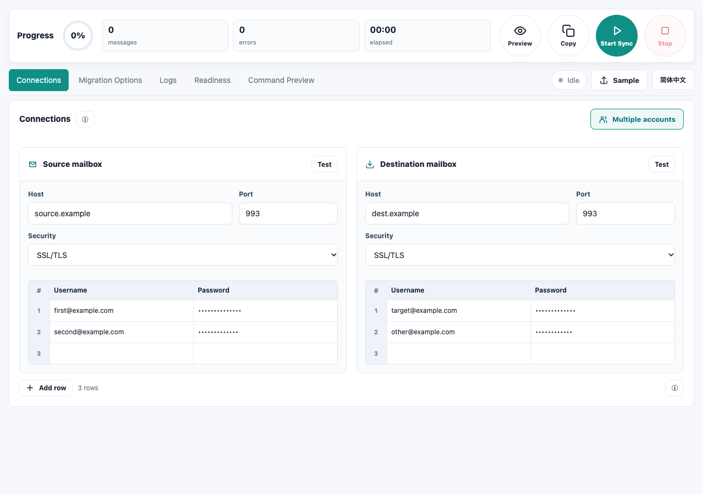

# Imapsync Studio

A desktop GUI for migrating email between IMAP servers, built with **Tauri 2, Rust, and Vite**. Transfer one account or queue multiple account pairs, preview commands, and monitor logs from a single window.

*Screenshot: English interface with example account data. No real mailbox transfer is shown.*

## Features

- Single-account and multiple-account migration modes.
- Two credential sheets with paired rows and spreadsheet paste support.
- Shared server settings, dry runs, migration filters, and provider-friendly rate limits.
- Always-visible preview, copy, start, stop, and progress controls.
- TLS certificate and hostname verification for encrypted connections.
- Password masking in previews and logs; passwords excluded from saved drafts.
- English, Japanese, and Simplified Chinese interfaces.

## Requirements

- Node.js and npm.
- Rust and the platform build prerequisites for Tauri 2.
- A separately installed `imapsync` executable.

On macOS, install imapsync with Homebrew:

```sh
brew install imapsync
```

The application looks for imapsync in `/opt/homebrew/bin`, `/usr/local/bin`, `/usr/bin`, and then `PATH`. macOS is the locally verified development platform; Windows and Linux runtime validation is pending.

## Run locally

```sh
npm ci
npm run tauri dev
```

Use the Tauri application for migration operations. The browser-only Vite interface does not provide the Rust backend needed to test connections or run imapsync.

## Migrate a single account

1. Open **Connections** and enter the source and destination host, port, and security mode. Typical ports are **993** for SSL/TLS and **143** for STARTTLS.
2. Enter the username and password for each mailbox.
3. Click **Test** on each side to check network and TLS connectivity. This check does not authenticate; authentication is tested when imapsync runs.
4. Open **Migration Options**. Keep **Dry run** enabled for the first run and configure any filters or limits.
5. Click **Preview**. The **Command Preview** tab opens automatically and shows the command with passwords masked. **Copy** copies that preview.
6. Click **Start Sync** to run the dry run, then review **Logs** for authentication failures, folder mappings, and errors.
7. After checking the results, turn off **Dry run** and click **Start Sync** to perform the migration.

**Sync deletes** enables deletion of destination messages missing from the source. Enable it only when that behavior is intended.

## Migrate multiple accounts

1. In **Connections**, click **Multiple accounts** at the right end of the section heading.
2. Enter the common source and destination server settings. These settings and the migration options apply to every pair.
3. Fill in the **Username** and **Password** columns in both sheets. Source row 1 maps to destination row 1, row 2 maps to row 2, and so on.
4. Use **Add row** to extend both sheets. Hover over a row number and click the × to remove that pair from both sheets.
5. To paste from Excel or another spreadsheet, copy two columns—username followed by password—and paste into a username cell. Each pasted line fills a row. Up to **1,000 rows** are supported.
6. Click **Preview** to review every account's command. Run a dry run first, then disable **Dry run** and start the actual migration.

All rows are validated before any migration starts. Completely empty pairs are skipped; incomplete pairs and duplicate destination accounts are rejected.

Pairs run **one at a time, from top to bottom**. An account failure is recorded and the queue continues; the overall run reports an error if any account fails. A process-launch failure stops the queue. **Stop** cancels the current process and all remaining pairs.

Row-number colors indicate running, successful, or failed accounts. The logs include row numbers and exit codes, while the top area shows the processed account count and aggregate transfer metrics. Hover over a row number for its result.

Click **Multiple accounts** again to return to single-account mode.

## Monitor, stop, and resume

- **Logs** displays runtime output, errors, and generated commands. Filter by errors or commands, and toggle automatic scrolling.
- Transfer counts come from imapsync's output. Error counts display `—` until imapsync reports a summary. Only the latest 1,200 log lines are retained, but aggregate counts remain available for the current run.
- The application stays in the stopping state until the process exits. On macOS/Linux, it sends TERM and forces termination after five seconds if necessary. Windows uses process termination.
- After a stopped or failed run, review the logs and restart with the same settings. There is no automatic retry.
- Keep the existing imapsync cache, especially when using **Compare by UID**. The app uses `$HOME/tmp`, or its local application data directory if `HOME` is unavailable. Avoid concurrent runs against the same mailbox.
- **Fast mode** skips the initial and final folder-size scans. It does not change how message identity is compared.

Settings, usernames, and the selected mode are restored from the saved draft. Passwords must be re-entered after restarting. During a run, passwords are passed through private temporary files rather than command-line arguments. Those files are deleted when the process finishes; an abnormal application termination may leave temporary files behind.

Use the language button beside **Sample** to cycle through Japanese, English, and Simplified Chinese. Hover over an **ⓘ** icon for help.

## Build

```sh
npm run tauri build
```

Build outputs are under `src-tauri/target/release/bundle/`. The application currently requires imapsync to be installed separately.

## Development checks

```sh
npm run build
cargo test --offline --manifest-path src-tauri/Cargo.toml
cargo clippy --offline --manifest-path src-tauri/Cargo.toml --all-targets -- -D warnings
```

The installed-imapsync option check is opt-in and does not connect to a mailbox:

```sh
cargo test --offline --manifest-path src-tauri/Cargo.toml installed_imapsync_accepts_generated_options -- --ignored --nocapture
```

See [VALIDATION.md](VALIDATION.md) for the tested scenarios and remaining validation work.

## Roadmap

- 🟢 [Done] Tauri 2 / Rust execution backend, five workspace tabs, and three UI languages.
- 🟢 [Done] Single-account migration, credential sheets, spreadsheet paste, sequential account queues, and per-account results.
- 🟢 [Done] Command previews, TLS verification, private password files, cancellation, and aggregate metrics.
- 🔴 [Later] Signed/notarized releases and investigation of bundled imapsync distribution.
- ⭕️ [Pending] Live-server authentication, message/attachment integrity, resume behavior, and deletion tests with disposable accounts.
- ⭕️ [Pending] Windows/Linux runtime and packaging verification.

## License

This project's code is licensed under the [MIT License](LICENSE).

imapsync is a separate executable. It and all third-party dependencies retain their own licenses.
